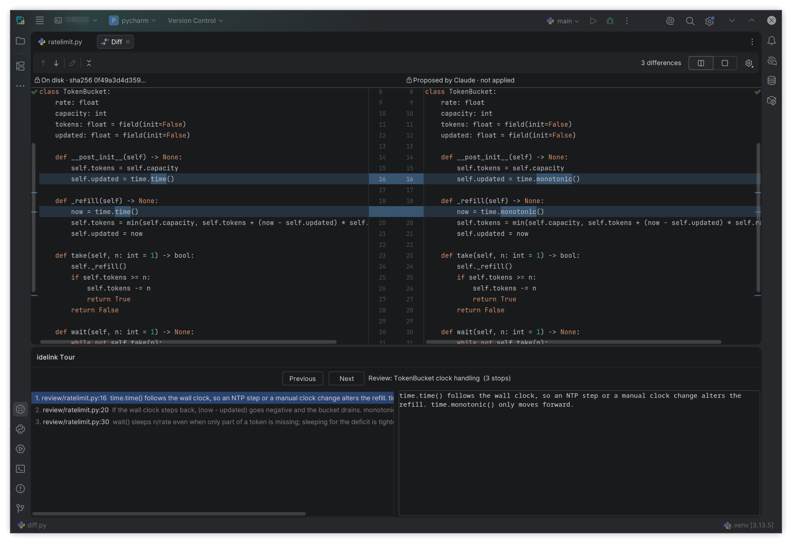

# idelink

idelink connects Claude Code, running on your remote development host, to the JetBrains IDE you use to work on
that host. Claude can open a file at a line and highlight it, show you a proposed change in the IDE's diff
viewer (show-only: it never writes), walk you through a change with a review tour, and read what you're looking
at: the active file, open tabs, your selection (with secrets withheld or scrubbed). It is deliberately narrow:
no command execution, no builds, no file writes, and every Claude session needs your approval in the IDE before
its first call.

## Supported setups

| Setup | v1 |
|---|---|
| JetBrains remote development over SSH (Gateway or Toolbox), backend on Linux x86_64 | yes |
| Coder workspaces with the JetBrains connector | yes |
| Local (non-remote) IDE | no; planned for v1.1 |

v1 is built for PyCharm 2026.2.4 (build 262.11879.98) and runs on 2026.2.4 through 2026.3 (builds 262.11879 to
263.7307.*) of JetBrains IDEs whose backend is `remote-dev-server`; an IDE update outside that range disables it
until a matching build exists. Claude Code must be installed system-wide (`/usr/bin/claude`) on the IDE host.

Tested live on the 2026.2.4 releases:

| IDE | Files, diffs, tours, terminal | Code analysis tools |
|---|---|---|
| PyCharm | yes | yes, with Python docstrings |
| GoLand | yes | yes |
| IntelliJ IDEA Ultimate | yes | yes (checked on Kotlin) |
| Rider | yes | not tested on a solution; C# analysis may not be reported |

## Install

See [docs/install.md](docs/install.md), written for people and for coding agents: an agent on the IDE host can
do the host-side steps and guide you through the rest (a root step, the client plugin, and approving the first
connection).

## Docs

- [Install](docs/install.md) and [troubleshooting](docs/troubleshooting.md)
- [Tools](docs/tools.md): what each tool does, returns and refuses
- [Architecture](docs/architecture.md): components, trust boundaries, what crosses each wire
- [Security](docs/security.md): what idelink guards against, what it doesn't, and how to verify a release
- [Decision log](docs/decisions.md)
- [AGENTS.md](AGENTS.md): building, testing and contributing (for agents and people)

## Security

idelink's access check on the host is a heuristic; the control a process running as you can't fake is your
approval in the IDE, so approve only connections you just asked for. That approval prompt can't vouch for
itself, and neither can anything else the IDE displays: trust a release because you (or someone you trust)
reviewed its source and its build-provenance attestation verifies, as described in
[docs/security.md](docs/security.md#verifying-a-release). Report vulnerabilities through a GitHub security
advisory, not a public issue.

## License

MIT; see [LICENSE](LICENSE).
